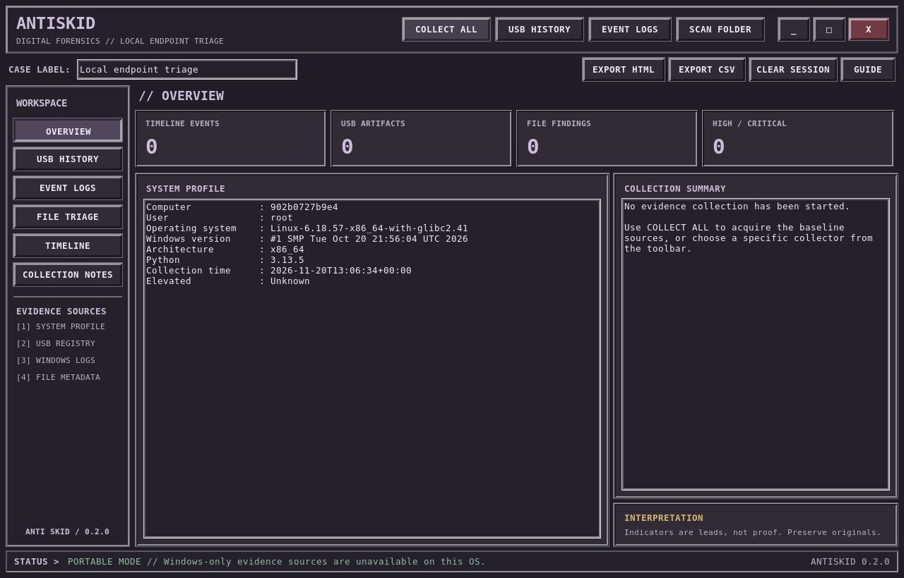
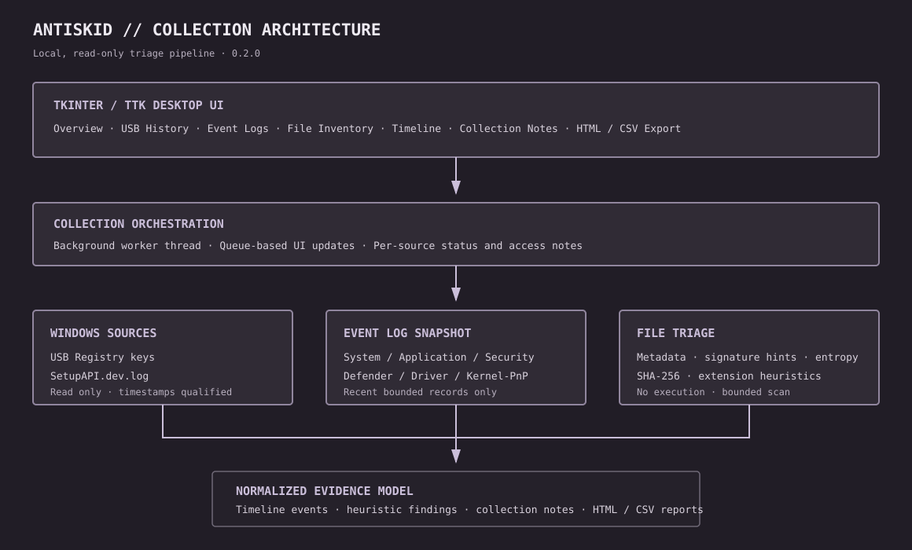

# AntiSkid — Digital Forensics

**AntiSkid** is a local Windows endpoint triage application with a retro, beveled desktop interface inspired by the supplied reference UI.

> **Project status: 0.2.0 — Improved alpha build.** It is a practical first-response helper, not a certified forensic suite, full disk imager, EDR, or antivirus replacement.

## Features in this build (0.2.0)

| Module | What it does |
|---|---|
| Overview | Shows local system profile and collection counts |
| USB History | Reads selected USB enumeration registry keys and matching entries in `setupapi.dev.log` |
| Windows Event Logs | Reads a bounded recent-event snapshot from System, Application, Security, Windows Defender, Driver Frameworks, and Kernel-PnP channels where available |
| File Triage | Walks a selected folder, records file metadata and SHA-256 for eligible files, and flags heuristic indicators |
| Timeline | Combines collected USB, event-log, and file-triage events into a searchable timeline |
| Reports | Exports a human-readable HTML report and CSV timeline |
| Evidence Notes | Reports unavailable sources, access errors, and collection limits |

### File triage indicators

- Executable and script-capable extensions.
- Potentially deceptive double extensions such as `invoice.pdf.exe`.
- Hidden executable/script files.
- A mismatch between a media/document extension and an `MZ` executable header.
- High-entropy samples, clearly labelled as a weak indicator because compressed/encrypted data can also have high entropy.
- SHA-256 hashes for files up to the configured 512 MiB per-file limit. Hashing checks source identity/size/mtime against the metadata sample and again after reading; it discards a result when a file changes during sampling or hashing.

Files are **never executed** by AntiSkid. The folder scan uses bounded defaults: maximum 2,000 files, maximum depth 8, deterministic sorted traversal, no following of symbolic links, and a 2 GiB aggregate hashing budget per scan. Inaccessible directories are listed in Collection Notes rather than silently ignored. Larger files are still inventoried, but their SHA-256 is skipped when they exceed the configured per-file or total hash budget.

## Interface

The GUI is written with Python's built-in **Tkinter/ttk**. Export HTML, export CSV, clear-session, and evidence-guide controls are available inside the themed interface (there is no native File/Tools/Help menu). The current build uses a dark plum/charcoal palette, square raised controls, compact monospace text, beveled panels, and a custom in-app window strip. On Windows, the native caption is hidden while the normal taskbar window and resizable frame are preserved; the old native File/Tools/Help menu is removed. It does not require a third-party UI framework.



### Architecture



## Requirements

- Windows 10/11 recommended for full collection support.
- Python 3.10 or newer.
- PowerShell available for Windows Event Log collection.
- No third-party Python packages are required in this build.

## Install and run

1. Extract the project folder.
2. Double-click `install.bat`.
3. When installation finishes, double-click `run.bat`.

Or start it from a terminal:

```powershell
py -3 antiskid.py
```

Run tests:

```powershell
py -3 -m unittest discover -s tests -v
```

Administrator privileges are **not** automatically requested. Some registry keys and event channels may return partial data or access-denied messages when run as a standard user. Run elevated only when you are authorized and need those sources.

## Recommended workflow

1. Record a case label in the **CASE LABEL** field.
2. Select **COLLECT ALL** for a baseline snapshot, or collect USB and event logs separately.
3. Open **Collection Notes** and review every unavailable, denied, skipped, or partial source.
4. Use **SCAN FOLDER** to triage a relevant directory. Prefer a working copy when preservation requirements are strict.
5. Review **File Triage**, **USB History**, **Event Logs**, and **Timeline**.
6. Export an HTML report and CSV timeline to a separate output drive/folder.
7. Keep the original system and evidence unchanged; document who collected the data, when, and with what permissions.

## Important interpretation limits

- **No 100% detection claim:** no general-purpose tool can guarantee discovery of every malicious file or every system activity.
- **Heuristics are not verdicts:** a suspicious extension, entropy value, or signature mismatch is a lead to investigate, not proof of malware.
- **Event log coverage is bounded:** this release reads up to 120 recent events per configured channel. Older events may not appear. Logs can be disabled, cleared, overwritten by retention, or inaccessible.
- **Audit policy matters:** events such as successful/failed logons or process creation appear only when Windows recorded them. Missing records do not prove that an action did not happen.
- **File timeline timestamps:** the application uses the observation timestamp captured at collection time, not a later re-read of the evidence file modification time.
- **USB Registry LastWrite is not an exact plug-in time:** it reflects modification time of a registry key and must not be presented as definitive connection/disconnection evidence.
- **SetupAPI log is supporting context:** entries are parsed from the local setup log; they are not a complete USB history.
- **Not a forensic image:** AntiSkid does not acquire raw disks, unallocated space, memory, browser databases, or every registry hive. It does not provide write-blocking or a verified chain-of-custody process.
- **No network upload:** this build does not send collected evidence to an online service. HTML/CSV reports can contain sensitive host/user/device information; protect them accordingly.
- **No intentional evidence writes by collectors:** collectors do not intentionally write to the source Registry, logs, or inspected files. However, reading files may update filesystem access metadata on systems where last-access updates are enabled. Exporting a report writes a new output file to the destination you choose.

## Security model

- No shell command is constructed from user-provided file paths.
- PowerShell is invoked with a fixed, read-only query script.
- The application does not clear logs, alter registry values, kill processes, quarantine, or execute inspected files.
- Directory symlinks are not followed; file symlinks are skipped.
- HTML report values are escaped before being written.
- CSV cells are prefixed when their first non-whitespace character is formula-triggering. Report export is atomic and refuses a destination matching any file collected in the current file inventory.

## Project structure

```text
AntiSkid/
├── antiskid.py
├── antiskid_core.py
├── antiskid_reports.py
├── requirements.txt
├── install.bat
├── run.bat
├── SECURITY.md
├── CHANGELOG.md
├── tests/
│   └── test_core.py
└── docs/
    └── architecture.svg
```

## Roadmap

- [ ] Add an explicit case/evidence manifest with collector version and operator notes.
- [ ] Add EVTX offline-file parsing with a vetted parser and integrity checks.
- [ ] Add targeted Security/Defender/PowerShell event-ID filters and richer event interpretation.
- [ ] Add Registry hive parsing from forensic copies, without modifying source hives.
- [ ] Add browser artifact parsers with clear support/version notes.
- [ ] Add signed release packaging and Windows CI tests.
- [ ] Add synthetic test fixtures for Windows Registry, PowerShell, and event-log collectors.
- [ ] Add a validated acquisition workflow for forensic images (separate from this triage app).

## License

No license has been assigned yet. Add a license file before accepting external contributions or redistributing modified copies.
